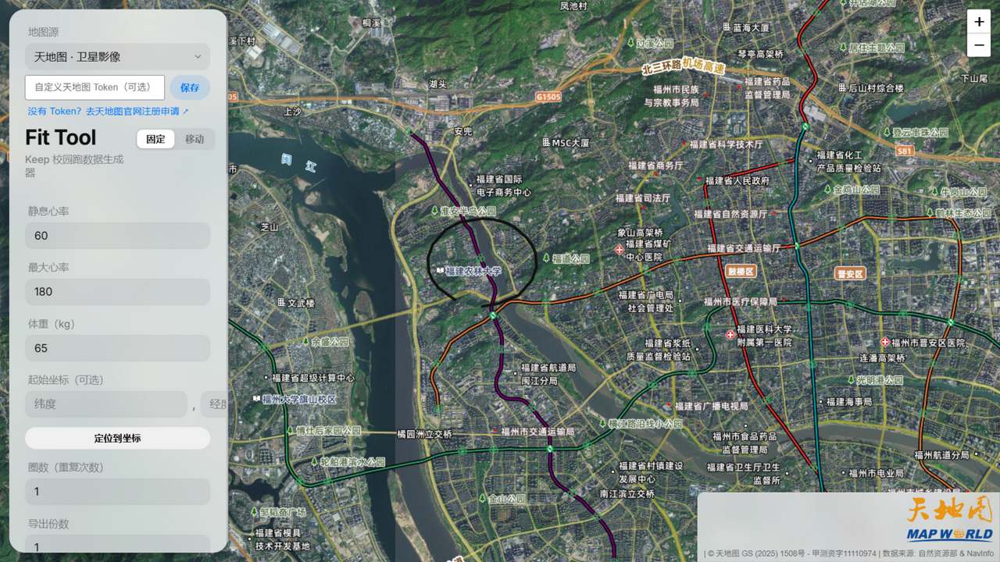

# Fit Tool — Keep 校园跑数据生成器

在地图上绘制跑步路线，一键生成符合 **Garmin FIT 标准**的运动数据文件（`.fit`），可导入 Keep 等运动平台。内置 1Hz 逐秒拟真采样：心率、步频、步幅、触地时间、垂直振幅、功率、海拔、卡路里一应俱全，速度 × 步频 × 步幅严格自洽。



> **⚠️ 免责声明**：本项目仅供学习研究、接口测试与数据格式研究之用。使用本工具伪造真实运动数据提交给学校考核或上传至商业平台，可能违反校规与平台用户协议，由此产生的一切后果由使用者自行承担。项目禁止任何商业用途。

## ✨ 功能特性

- 🗺️ **多地图源**：天地图矢量 / 卫星影像 / 地形、OpenStreetMap、Esri 世界影像，全部为无坐标偏移图源（WGS-84 / CGCS2000），画在哪条路，生成的轨迹就在哪条路
- 🔑 **Token 自助管理**：填入自己的天地图 Token 点保存即生效，存浏览器本地，下次打开自动使用；附带官网申请入口
- 🪟 **苹果风格界面**：全屏地图 + 悬浮毛玻璃面板；面板支持 **固定 / 移动** 双模式，移动模式下位置、宽度、高度均可自由拖拽并记忆
- 🏃 **1Hz 拟真数据**：逐秒采样，含热身心率爬升、速度长周期体力波动、GPS 平滑漂移、多圈轨迹偏移等拟真细节
- 📊 **实时预览**：配速 / 心率 / 步频三条曲线 + 地图轨迹回放，生成前先看效果
- 🎲 **批量生成**：一次导出多份自动打包为 ZIP；日期排布 4 种模式；可选随机增减公里数
- 🛡️ **健壮性**：服务端完整参数校验、仅监听本机、端口占用自动顺延、瓦片加载失败提示

## 🚀 快速开始

### 环境要求

- Windows 10 / 11（一键启动脚本为 Windows 批处理）
- [Node.js](https://nodejs.org/) **18 或更高版本**（LTS 即可；仓库不含内置运行时，需自行安装）
- 首次运行需要联网安装依赖

### 安装与启动

1. 下载本项目：绿色按钮 **Code → Download ZIP** 解压，或

   ```bash
   git clone https://github.com/<你的用户名>/<仓库名>.git
   cd <仓库名>
   ```

2. **双击 `run-fit-tool.cmd`**：
   - 首次运行会自动执行 `npm install` 安装依赖（需联网，约半分钟）
   - 服务器就绪后浏览器**自动打开** `http://localhost:3000`
   - 之后每次使用：双击同一个文件即可，无需重复安装

3. **停止服务**：直接关闭那个最小化的命令行窗口。

> 💡 想要桌面图标：右键以 PowerShell 运行 `tools\make-shortcut.ps1`，会在桌面创建带应用图标的快捷方式。
>
> 💡 习惯命令行的用户：`npm install && npm start` 效果相同。

## 📖 使用教程

### 1. 认识界面

打开页面后，左侧是一块悬浮毛玻璃面板，右侧是全屏地图：

| 区域 | 说明 |
| --- | --- |
| 标题行「固定 / 移动」 | 面板模式开关。**固定**（默认）：面板停靠左上、撑满高度，只可调宽度；**移动**：面板可拖到屏幕任意位置，宽高均可调 |
| 拖拽把手 | 移动模式下，拖标题区或右上角「⠿」抓手移动面板；右缘调宽、底缘调高、右下角宽高同调；**双击抓手**面板复位 |
| 地图源下拉框 | 切换底图，选择会被记住 |
| Token 输入行 | 填自己的天地图 Token（可选，见下文） |

面板宽度和位置都会自动记忆，刷新页面后保持你上次调整的样子。

### 2. 选择地图源与配置 Token

- 下拉框里有 5 个图源：**天地图矢量（默认）、天地图卫星影像、天地图地形、OpenStreetMap（备用）、Esri 世界影像**。想看清校园小路画点更准，推荐**卫星影像**。
- **天地图 Token（可选但推荐）**：
  1. 点击面板里的「去天地图官网注册申请」打开 [map.tianditu.gov.cn](https://map.tianditu.gov.cn/)
  2. 注册并登录后，进入「开发资源 → 控制台」创建一个**浏览器端**类型的应用，得到一串 32 位密钥（Token）
  3. 把 Token 粘贴进面板输入框，点「保存」——立即生效，并保存在本机，下次打开自动使用
  4. 想恢复默认：清空输入框再点保存
- 不申请也能用：工具内置了一个公共 Token，但额度与他人共享，推荐用自己的。

### 3. 绘制跑步路线

- **直接在地图上点击**即可添加路径点，系统自动连线；点越多、越贴合真实道路，效果越好
- 「撤销上一步」「清除轨迹」随时修正
- 「定位到坐标」：输入经纬度快速跳转；「尝试获取当前位置」：浏览器授权后跳到你附近（需 HTTPS 或 localhost 环境）
- 「轨迹平滑度」滑杆：把折线拐角变成圆滑曲线（Catmull-Rom 样条），数值越大越平滑
- 「圈数（重复次数）」：大于 1 时路线首尾自动闭合，每圈叠加 0.3~1.5 米的自然漂移，支持 2.5 这类小数圈
- 「导入轨迹 / 导出轨迹」：路线以 JSON 文件保存，方便下次复用或分享给别人：

  ```json
  {
    "version": 1,
    "exportedAt": "2026-10-03T07:00:00.000Z",
    "lapCount": 1,
    "smoothness": 5,
    "points": [{ "lat": 26.0745, "lng": 119.2565 }, ...]
  }
  ```

### 4. 设置运动参数

| 参数 | 说明 | 默认值 |
| --- | --- | --- |
| 静息心率 | 晨起安静状态心率，用于心率模型爬升起点 | 60 |
| 最大心率 | 约 `220 − 年龄`，用于控制运动心率上限 | 180 |
| 体重（kg） | 参与卡路里与功率计算，支持一位小数 | 65 |
| 圈数 | 路线重复圈数，见上节 | 1 |
| 导出份数 | 一次生成几个 .fit 文件（>1 自动打包 ZIP） | 1 |
| 日期排列 | 见下方四种模式 | 当天生成多份 |
| 随机时间区间 | 每份文件的开始时刻在此区间随机 | 06:00 ~ 08:00 |
| 配速区间 | 每份文件随机取区间内一个配速（分′秒″/km） | 8′00″ ~ 9′36″ |
| 随机增减公里数 | 每份在基础距离上随机缩放 ±N%，可用最低/最高公里数夹紧 | 关 |

**「打乱文件编号顺序」**：导出多份时随机命名 `runfit(N).fit`，适合分多天逐个使用。

**日期排列四种模式**：

- **当天生成多份**：同一天随机多个时刻，自动按时间排序并保证两次跑步不重叠（间隔 = 上次预估时长 + 10 分钟）
- **按日期往下排**：从今天起每天一份
- **按选择日期生成**：同一天，但以你选的日期为准
- **从选择日期往下排**：从所选日期起每天一份

### 5. 预览曲线与轨迹回放

点「预览曲线」，面板下方会生成**配速 / 心率 / 步频**三条曲线，同时地图上出现一个圆点沿路线回放，实时显示 时间 / 配速 / 心率。预览使用的参数与第一份导出一致。

### 6. 生成 FIT 文件并导入 Keep

1. 点 **「生成 FIT 文件」**
2. 单份直接下载 `runfit.fit`；多份自动打包为 `runfit_N份.zip`（含全部文件）
3. 导入 Keep：
   - 打开 Keep App，进入「我的 → 设置 → 数据导入」（不同版本入口略有差异，一般在设置或运动记录页）
   - 选择下载的 `.fit` 文件导入
   - 导入成功后即可在运动记录中看到这次"跑步"的距离、时长、配速、心率、步频等数据

> 校园跑通常要求路线落在指定区域内、配速在限定范围内。绘制路线前先确认学校规则（区域范围、最低公里数、配速区间），再对应设置参数。

### 7. 生成前验证参数（服务端校验）

为避免生成无效文件，服务端会校验：轨迹点数量与坐标范围、点数 × 圈数上限、单次总时长 ≤ 24 小时、静息心率 < 最大心率、配速在 1'30" ~ 30'00" /km 之间。不合法的参数会返回明确的中文错误提示。

## 🧮 数据生成原理（一图看懂）

```
地图点击 → 折线点列 → (平滑) → (圈数展开 + 多圈漂移)
        → haversine 累计距离 → 按配速反推总时长
        → 1Hz 逐秒采样：速度(归一化+体力波动) → 沿线插值坐标 + GPS 漂移
                       → 心率(爬升模型) → 步频 → 步幅 = 速度 ÷ 步频
                       → 触地时间 / 垂直振幅 / 功率 / 海拔
        → @garmin/fitsdk 编码 RECORD(1Hz) + LAP + SESSION + ACTIVITY
        → .fit 文件（含 CRC 校验，可被标准解码器读取）
```

卡路里采用 ACSM 跑步代谢公式（平地）：`VO₂ = 0.2×速度 + 3.5`，按 5 kcal/L 氧气换算，65kg 每公里约 74 kcal，与主流运动手表一致。

## 🗂️ 项目结构

```
fit-tool/
├─ server.js              # Express 后端：参数校验 + 1Hz 拟真采样 + FIT 编码
├─ public/
│  ├─ index.html          # 页面骨架
│  ├─ main.js             # 前端逻辑：地图、面板、预览、Token 管理
│  ├─ style.css           # 苹果风格样式
│  ├─ jszip.min.js        # 多文件 ZIP 打包（本地，无 CDN 依赖）
│  └─ favicon.png
├─ tools/
│  ├─ make-icon.js        # 重新生成应用图标（零依赖）
│  └─ make-shortcut.ps1   # 创建桌面快捷方式
├─ fit-tool.ico           # 应用图标
├─ docs/screenshot.png
├─ run-fit-tool.cmd       # Windows 一键启动
├─ LICENSE                # CC BY-NC-SA 4.0
└─ package.json
```

> 你用「导出轨迹」保存的路线 JSON 属于个人数据，不会被上传；把文件放进 `route/` 目录（已加入 .gitignore）也仅保存在本机。

## 🛠️ 二次开发

```bash
npm install     # 安装依赖
npm start       # 启动（或 node server.js）
```

- **改前端**（`public/` 下的任何文件）：保存后**刷新浏览器**即可生效
- **改后端**（`server.js`）：需要重启服务（关掉命令行窗口重新启动）
- **换应用图标**：修改 `tools/make-icon.js` 里的配色 / 图案后运行 `node tools/make-icon.js`，然后重跑 `tools/make-shortcut.ps1`

## ❓ 常见问题

**Q：地图一片白/灰，瓦片加载不出来？**
多为网络原因。依次尝试：切换其他地图源 → 在面板填入自己的天地图 Token → 检查代理/防火墙。OpenStreetMap 在国内直连时常不稳定。

**Q：双击 cmd 后窗口一闪而过？**
未安装 Node.js 或版本过低。安装 Node.js 18+ 后重试；窗口里会有明确的错误提示。

**Q：提示 3000 端口被占用？**
服务器会自动顺延到 3001、3002…并打开正确地址，无需处理；想固定端口可用 `set PORT=3000` 后启动。

**Q：多圈的轨迹为什么会左右漂移？**
刻意为之：真实跑步者每圈足迹不会完全重合，逐圈叠加 0.3~1.5 米漂移更贴近真实 GPS 记录。

**Q：预览的曲线和实际生成的数据一样吗？**
采样算法一致；若开启了「随机增减公里数」，预览展示的是其中一种随机结果，每份实际文件会各自随机。

**Q：会被 Keep 检测出来吗？**
本工具生成的是结构合法的标准 FIT 文件，但不承诺也不研究对抗平台风控。再次提醒：伪造数据提交考核的合规风险自担。

## 📝 更新日志

### V1.1（原作者项目）
- 地图源更换为天地图，解决部分网络环境地图不显示的问题
- 新增定位功能

### V1.2（原作者项目）
- 扩充文件数据量，新增卡路里与步频算法

### V1.3（原作者项目）
- 修复体重上限校验、FIT 步频汇总与逐点记录不一致、timeCreated 时间字段错误
- 请求体上限提升，锁定 @garmin/fitsdk 版本；补 Chart.js SRI 校验；静息心率前置校验

### V1.4（本仓库增强版）
- 服务器仅监听本机；完整服务端参数校验（点数/圈数/时长/心率/配速范围）
- 修复随机公里数被钳制导致多份文件距离雷同；当天多份自动排序防时间重叠
- 体重支持小数；导出份数输入防抖；预览同步随机距离缩放

### V1.4.1
- 修复浏览器无法自动打开的问题（改为服务器就绪后自动弹出正确地址）

### V1.4.2
- 重做侧边栏拖拽：把手不再随内容滚出可视区，指针捕获 + 宽度记忆 + 双击复位 + 键盘可达

### V1.4.3
- 新增地图源选择器（5 个无偏移图源），版权信息随源联动

### V1.4.4
- UI 苹果化改版：全屏地图 + 悬浮毛玻璃面板、SF 排版、语义色、按下即时反馈
- 减弱动效 / 减弱透明度无障碍适配；小屏 bottom sheet 布局

### V1.4.5
- 面板位置与尺寸完全可调（移动 / 调宽 / 调高 / 角拖），全部记忆

### V1.4.6
- 面板固定 / 移动双模式（默认固定）；修复自由模式下按钮点击被指针捕获吞掉的问题

### V1.4.7
- 新增应用图标与浏览器 favicon；桌面一键启动快捷方式脚本

### V1.4.8 / V1.4.9
- 天地图 Token 自助管理（保存即生效、长期记忆、官网申请入口）

### V1.5.0
- 面向开源发布：重写使用文档、图标与快捷方式脚本通用化、启动脚本增加 Node 环境检测

## 🙏 致谢

**原作者**

- **Fit Tool** — 开发者 [Ruomu Yunxi]（B站 [@黑心商家瑶瑶](https://space.bilibili.com/439315192)）
- V1.1 版本更新由 [@陈某超废啦](https://space.bilibili.com/644117347) 提供

**本增强版**

- 界面重做（苹果风格悬浮面板、固定/移动双模式）、多地图源与 Token 自助管理、拟真数据增强、工程化修复与开源发布准备
- 维护者：**zhexuan** ｜ GitHub：https://github.com/zhexuan666777888 ｜ 联系：QQ 3453396159

**开源依赖与数据源**

- [Leaflet](https://leafletjs.com/) · [Chart.js](https://www.chartjs.org/) · [JSZip](https://stuk.github.io/jszip/) · [@garmin/fitsdk](https://developer.garmin.com/fit/)
- 图源：[天地图](https://map.tianditu.gov.cn/) · [Esri](https://www.esri.com/) · [OpenStreetMap](https://www.openstreetmap.org/)

## 📄 开源协议

本项目遵循 **[CC BY-NC-SA 4.0](https://creativecommons.org/licenses/by-nc-sa/4.0/deed.zh)**（署名—非商业性使用—相同方式共享）协议开源：

- ✅ 自由使用、修改、再分发（需署名并以相同协议开源）
- ❌ 不得用于商业目的
- 修改发行时必须保留原作者署名并标注改动
